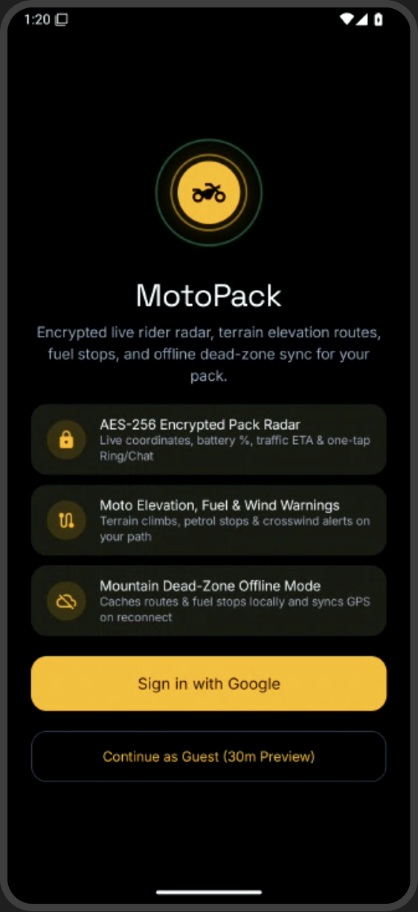
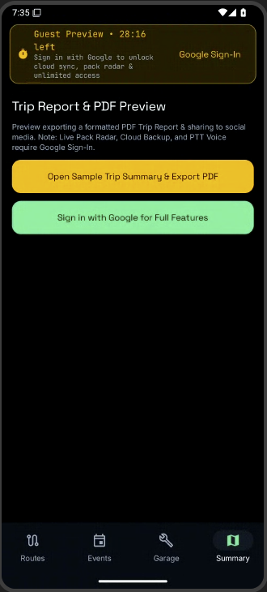
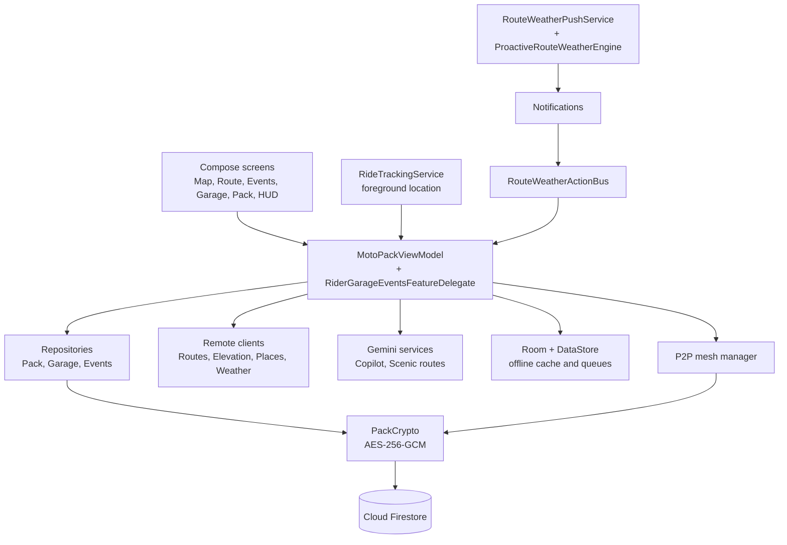

<div align="center">


# MotoPack

**Ride together. Stay together.**

Real-time group riding for motorcyclists: a live rider radar on Google Maps, encrypted pack telemetry,
elevation-aware routes, proactive weather alerts, push-to-talk voice and an offline mode for dead zones.


</div>

---

## Contents

- [What it does](#what-it-does)
- [Screenshots](#screenshots)
- [Tech stack](#tech-stack)
- [Getting started](#getting-started)
- [Configuration](#configuration)
- [Running the tests](#running-the-tests)
- [Project layout](#project-layout)
- [Architecture](#architecture)
- [Firestore data model](#firestore-data-model)
- [Security notes](#security-notes)
- [Working with AI assistants](#working-with-ai-assistants)
- [Known gaps](#known-gaps)

## What it does

| Area | Features |
| --- | --- |
| **Map and radar** | Live position, speed, heading and altitude of every rider in your pack on Google Maps. Separation alerts when someone drops off the back. Shared pins and a pack photo gallery. |
| **Packs** | Create a pack, share an invite code, chat, send urgent "ring / ping" alerts, set challenges and plan pack events. Up to 30 members per pack. |
| **Route planner** | Routes from the Google Routes API with an elevation and grade profile, fuel stops from Places, and an AI scenic route suggester (twisties, scenic views, café cruise or smooth flow). |
| **Weather shield** | Scans the corridor ahead for thunderstorms, heavy rain, crosswinds and ice risk, then sends a notification with one-tap "route to safe stop" or "detour around hazard" actions. |
| **Rider HUD** | A glanceable, high-contrast riding screen with a night (OLED amber) and day theme, plus an eco mode that eases off GPS polling to save battery. |
| **AI copilot** | Gemini-powered convoy advice, structured safety briefings and short spoken HUD callouts, through Firebase AI Logic. |
| **Push to talk** | Short voice clips (up to 20 s, AMR or AAC) sent to the pack, with auto-play and an offline queue. |
| **Offline mode** | Download map areas, cache routes, riders and pins in Room, and queue breadcrumbs and voice clips until signal returns. |
| **P2P convoy mesh** | Experimental Wi-Fi Direct and local-network relay for telemetry, chat, voice and SOS between nearby riders with no mobile signal. |
| **Emergency SOS** | An SOS sheet that alerts the pack with your position and offers a locale-aware emergency number. |
| **Garage** | Your bikes, maintenance reminders with health status, and a service history log. |
| **Events and passport** | Biker events and a "Biker & Brew Passport" that collects stamps and ranks. |
| **Trip reports** | A trip summary dashboard with a formatted PDF export and a share-to-social caption. |
| **Guest preview** | Try routes, events, garage and trip reports for 30 minutes without signing in. Pack radar, cloud sync and voice need Google Sign-In. |

## Screenshots

| Sign-in | Guest preview, trip summary |
| :---: | :---: |
|  |  |

## Tech stack

- **Language and UI:** Kotlin 2.2, Jetpack Compose (Material 3), Navigation Compose with type-safe routes
- **Build:** Gradle 9.3.1, Android Gradle Plugin 9.1.1, KSP, version catalog in [gradle/libs.versions.toml](gradle/libs.versions.toml)
- **Android targets:** `minSdk` 24, `targetSdk` 36, Java 11 bytecode
- **Backend:** Firebase Auth (Google Sign-In through Credential Manager), Cloud Firestore, Firebase AI Logic (Gemini), App Check
- **Maps and data:** Google Maps Compose, Routes API, Elevation API, Places API (New), OpenWeatherMap, Open-Meteo
- **Local storage:** Room (offline cache and queues), DataStore (preferences)
- **Networking:** Retrofit, OkHttp, Moshi, kotlinx.serialization
- **Testing:** JUnit 4, Robolectric, Compose UI tests, Firebase Emulator Suite, `@firebase/rules-unit-testing`

## Getting started

This project was created in Google AI Studio, which supplies a few build files itself. A fresh clone needs
those files added before it will build locally. The steps below cover each one.

### Prerequisites

- [Android Studio](https://developer.android.com/studio) (latest stable), which bundles a suitable JDK and the Android SDK. Command-line builds need JDK 17 or newer.
- Android SDK Platform 36
- A Firebase project with **Authentication (Google)**, **Cloud Firestore**, **AI Logic** and **App Check** enabled
- A Google Maps Platform API key and an OpenWeatherMap API key
- Node.js 20 or newer, only if you want to run the Firestore rules tests

### 1. Clone

```bash
git clone git@github.com:mohamedshez/MotoPack.git
```

### 2. Add the Gradle wrapper

The repository has `gradle/wrapper/gradle-wrapper.properties` but no `gradlew` script or wrapper JAR.
Opening the project in Android Studio works without them. For command-line builds, generate them once
(needs a local Gradle, for example `brew install gradle`):

```bash
gradle wrapper --gradle-version 9.3.1
```

### 3. Create a debug keystore

The debug build is signed with `debug.keystore` in the project root, which is git-ignored. Create one:

```bash
keytool -genkeypair -v -keystore debug.keystore -storepass android -alias androiddebugkey -keypass android -keyalg RSA -keysize 2048 -validity 10000 -dname "CN=Android Debug,O=Android,C=US"
```

Print its SHA-1 so you can register it in Firebase (Google Sign-In fails without it):

```bash
keytool -list -v -keystore debug.keystore -storepass android -alias androiddebugkey
```

### 4. Add `google-services.json`

In the Firebase console, register an Android app with package name `com.aistudio.motopack.rvkzmw`, add the
SHA-1 from step 3, then download `google-services.json` into `app/`.

This file is required. The sign-in code reads `R.string.default_web_client_id`, which the Google Services
plugin generates from it, so the app does not compile without it.

### 5. Add your API keys

```bash
cp .env.example .env
```

Then edit `.env` (see [Configuration](#configuration)). The file is git-ignored.

### 6. Build and run

```bash
./gradlew installDebug
```

Or press **Run** in Android Studio. Use an emulator image with Google Play services, or a physical device.

## Configuration

### API keys (`.env`)

The [Secrets Gradle Plugin](https://github.com/google/secrets-gradle-plugin) reads `.env` and falls back to
`.env.example`, exposing each key through `BuildConfig`.

| Key | Used for | Where to get it |
| --- | --- | --- |
| `MAPS_API_KEY` | Maps SDK for Android, Routes API, Elevation API, Places API (New) | [Google Cloud console](https://console.cloud.google.com/google/maps-apis). Enable all four APIs on the key. |
| `OPENWEATHER_API_KEY` | Live rain and high-wind rider alerts | [OpenWeatherMap](https://openweathermap.org/api) |

Open-Meteo, used for forecasts and fallback elevation, needs no key.

### Firebase

- **Firestore database:** the app uses a named database, not `(default)`. The ID is in
  [firebase_applet_config.xml](app/src/main/res/values/firebase_applet_config.xml) and
  [firebase.json](firebase.json). Change both if you point the app at your own project.
- **Security rules:** deploy [firestore.rules](firestore.rules) with `firebase deploy --only firestore:rules`.
- **App Check:** release builds use reCAPTCHA (site key in `firebase_applet_config.xml`). Debug builds use the
  debug provider and take the token from an intent extra. Register a debug token in the Firebase console,
  then launch with:

  ```bash
  adb shell am start -n com.aistudio.motopack.rvkzmw/com.example.MainActivity --es FIREBASE_APPCHECK_DEBUG_TOKEN "<your-debug-token>"
  ```

- **Gemini models:** model names are set in
  [MotoAiCopilotService.kt](app/src/main/java/com/example/ai/MotoAiCopilotService.kt) and
  [ScenicRouteSuggesterService.kt](app/src/main/java/com/example/ai/ScenicRouteSuggesterService.kt).

### Release signing

Release builds read `KEYSTORE_PATH` (default `my-upload-key.jks`), `STORE_PASSWORD` and `KEY_PASSWORD` from
the environment, with key alias `upload`.

## Running the tests

**Unit and UI tests** (Robolectric, 46 tests). The two repository rule tests talk to the Firebase emulators
on `127.0.0.1` (Firestore on 8085, Auth on 9099), so run the suite inside them:

```bash
npx firebase-tools emulators:exec --only firestore,auth --project demo-no-project "./gradlew testDebugUnitTest"
```

**Firestore security rules** (Node test runner, 12 tests in [firestore.test.js](firestore.test.js)). There is
no `package.json`, so install the two dependencies first:

```bash
npm install --no-save @firebase/rules-unit-testing firebase
```

```bash
npx firebase-tools emulators:exec --only firestore --project demo-no-project "node --test firestore.test.js"
```

Each test task fails fast and times out after two minutes.

## Project layout

```text
MotoPack/
├── app/
│   ├── build.gradle.kts            App module: SDK levels, signing, dependencies
│   └── src/
│       ├── main/
│       │   ├── AndroidManifest.xml Permissions, services, FileProvider
│       │   ├── java/com/example/
│       │   │   ├── MainActivity.kt Entry point; routes weather notification actions
│       │   │   ├── ai/             Gemini copilot, scenic route suggester, App Check setup
│       │   │   ├── audio/          Push-to-talk recording and playback
│       │   │   ├── auth/           Google Sign-In with Credential Manager
│       │   │   ├── data/
│       │   │   │   ├── crypto/     AES-GCM pack encryption
│       │   │   │   ├── local/      Room database, DataStore, offline map areas
│       │   │   │   ├── model/      Firestore, garage and event models
│       │   │   │   ├── remote/     Routes, Elevation, Places and weather clients
│       │   │   │   └── repository/ Pack, garage and events repositories
│       │   │   ├── export/         Trip report PDF and sharing
│       │   │   ├── location/       Foreground ride tracking, telemetry, notifications
│       │   │   ├── mesh/           Wi-Fi Direct mesh and VPN service
│       │   │   ├── ui/             Navigation, screens, theme, view model
│       │   │   └── weather/        Proactive route weather engine
│       │   └── res/                Icons, fonts, strings, themes
│       ├── test/                   Robolectric unit, UI and emulator rule tests
│       └── androidTest/            Instrumented test stub
├── gradle/libs.versions.toml       Version catalog
├── firestore.rules                 Security rules (default deny, per-collection validation)
├── firestore.test.js               Security rules tests
├── firebase.json                   Firestore database and emulator ports
├── firebase-blueprint.json         JSON schema of the Firestore entities
├── .env.example                    API key template
└── docs/screenshots/               Images for this README
```

The code lives in the `com.example` namespace. The installed application ID is `com.aistudio.motopack.rvkzmw`.

## Architecture



- **Single activity.** [MainActivity.kt](app/src/main/java/com/example/MainActivity.kt) hosts `MotoPackRoot` in
  [MotoPackApp.kt](app/src/main/java/com/example/ui/MotoPackApp.kt), which owns navigation. Phones get a bottom
  bar and screens 600 dp or wider get a navigation rail.
- **One view model.** [MotoPackViewModel.kt](app/src/main/java/com/example/ui/viewmodel/MotoPackViewModel.kt)
  holds app state as `StateFlow`s and coordinates repositories, services and the offline queue.
- **Online first, offline capable.** Telemetry and messages go to Firestore when connected. Without signal they
  are queued in Room and can be relayed over the local mesh.
- **Foreground services.** `RideTrackingService` (location), `RouteWeatherPushService` (data sync) and
  `MotoPackMeshVpnService` (VPN) keep rides running with the screen off.

## Firestore data model

Everything is denied by default, then opened per collection with field-level validation. The full schema is in
[firebase-blueprint.json](firebase-blueprint.json).

```text
users/{userId}
├── trips/{tripId}
├── passport_stamps/{stampId}
├── biker_events/{eventId}
├── garage_bikes/{bikeId}
├── maintenance_items/{itemId}
└── service_logs/{logId}

pack_invites/{inviteCode}

packs/{packId}
├── members/{memberUid}        encrypted telemetry
├── messages/{messageId}       encrypted chat and voice
├── pings/{pingId}
├── challenges/{challengeId}
├── markers/{markerId}
├── photos/{photoId}
└── events/{eventId}
```

## Security notes

- Pack telemetry and messages are encrypted on the device with AES-256-GCM and a random 12-byte IV per message
  before they are written to Firestore. See [PackCrypto.kt](app/src/main/java/com/example/data/crypto/PackCrypto.kt).
- **Limitation:** the pack key is a single SHA-256 hash of the invite code and a salt, and both are stored in
  Firestore. That keeps data private from non-members, but anyone with database access can derive the key, so
  this is not end-to-end encryption in the strict sense. A proper key derivation function and a key that never
  leaves members' devices would close the gap.
- Never commit `.env`, `google-services.json`, `debug.keystore` or any release keystore. Restrict the Maps key
  to this app's package name and SHA-1 in the Google Cloud console.
- Background ride tracking runs in a foreground service with a visible notification.

## Working with AI assistants

Tips for using Claude, ChatGPT or another coding assistant on this repository:

- Point the assistant at this README first, then at the specific package you are changing.
- A few files are large. Ask for targeted reads of
  [MotoPackViewModel.kt](app/src/main/java/com/example/ui/viewmodel/MotoPackViewModel.kt) (about 2,800 lines) and
  [MapRadarScreen.kt](app/src/main/java/com/example/ui/screens/MapRadarScreen.kt) (about 1,600 lines) instead of
  whole-file dumps.
- When a change touches a Firestore document shape, update the model in `data/model/`,
  [firestore.rules](firestore.rules), [firebase-blueprint.json](firebase-blueprint.json) and the rules tests
  together. The rules validate every field, so a missed update shows up as a permission error at runtime.
- The comments in [app/build.gradle.kts](app/build.gradle.kts) that say "do not remove or modify" protect the
  signing setup AI Studio relies on. Leave them in place if you still build there.

## Known gaps

- No Gradle wrapper script, debug keystore or `google-services.json` in the repository (see
  [Getting started](#getting-started)).
- No `package.json` for the rules tests and no CI workflow.
- No licence file. Until one is added, all rights are reserved by the author.
- The namespace is still the template default, `com.example`.
- Release builds have minification turned off.
- The Wi-Fi Direct mesh and mesh VPN are experimental and need real devices to test.
